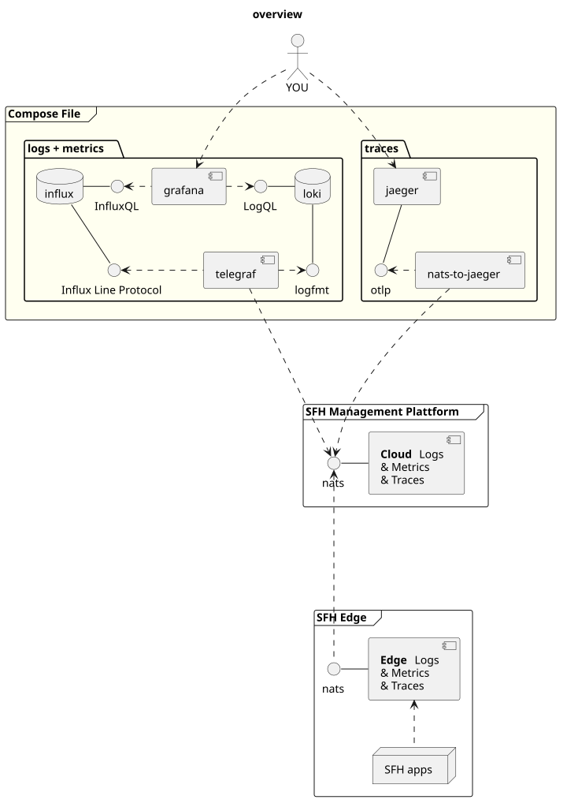

# SFH custom metrics example

This example project shows one way to store and browse logs and metrics streamed from the SFH management platform. On initialization it will start these preconfigured containers:

- **telegraf** that connects to the SFH Management Platform and streams logs and metrics into the dedicated databases
- **influxdb** to store and serve metrics data
- **loki** to store and serve logs
- **grafana** as frontend to browse logs and metrics stored in influx and loki
- **jaeger** to receive and visualize traces
- **nats-to-jaeger** to subscribe to Telegraf trace messages on NATS, reconstruct OTLP/HTTP JSON, and forward the result to Jaeger

## usage

You need to provide the app-id of your application and a valid access-token. Later one you can obtain copied into your clipboard by pressing `t` while beeing logged in on the [SFH Management Platform](https://console.smartfactoryhost.com) or via your [user profile](https://console.smartfactoryhost.com/user/profile).

To start the example setup, run `docker compose up` with the required environment variables set accordingly.

- `APPID`: the numeric id of your sfh application
- `TOKEN`: the access token you can get from your [user profile](https://console.smartfactoryhost.com/user/profile)
- `SPONSORID`: sponsor id used in the SFH NATS topic  (optional)
- `SFHID`: SFH id used in the SFH NATS topic (optional)
- `PROVIDERID`: provider id used in the SFH NATS topic (optional)
- `NATS`: NATS server, for example `nats.smartfactoryhost.com:4222` (optional)

```sh
TOKEN="<token>" APPID="<appId>" docker compose up
```

> ⚠️ In some cases, the influxdb fails to initialize. In such a case, stop the docker compose by pressing `<ctrl-c>` and start over with the command above.
>
> ⚠️ Be aware of the token you passed will become invalid after some minutes. So if you restart the compose file with a new token, you need to run `docker compose rm telegraf` first. Otherwise it will continue to use the old invalid token.

## explore metrics

Point your browser to [grafana](http://localhost:33000/d/b494e75a-e3ce-44fc-b8fa-8685c330a538/resources-dashboard-example?orgId=1&refresh=30s), login as user `admin` with password `password` and explore the data becoming available.

## explore traces

Point your browser to the Jaeger UI available at [http://localhost:16686](http://localhost:16686).

### remarks about otlp messages

Traces are consumed from the subject below and forwarded to Jaeger OTLP/HTTP endpoint `http://jaeger:4318/v1/traces`:

`sponsor.${SPONSORID}.sfh.${SFHID}.provider.${PROVIDERID}.app.${APPID}.otlp`

Notes:

- The payload on this NATS topic is the Telegraf `data_format="json"` representation of measurements such as `spans`, `logs`, and `span-links`, not raw OTLP JSON.
- Forwarding is done by the `nats-to-jaeger` container, not by Telegraf.
- The converter rebuilds OTLP JSON from the Telegraf span records. It derives `startTimeUnixNano` from `end_time_unix_nano - duration_nano` when available, preserves `service.name` as resource attribute for Jaeger, and attaches matching span events or links if they arrive shortly after the span record.
- Because Telegraf flattens OTLP into measurements, the reconstruction is necessarily lossy for some original resource versus span versus scope boundaries. The sender side remains unchanged.

## overview

The diagram below shows the containers set up after running `docker-compose up`.



------

## appendix

### stream logs via CLI

```bash
export APPID=...
export TOKEN="ey..."
nats --user openid --password $TOKEN -s nats://nats.smartfactoryhost.com  subscribe "sponsor.*.sfh.*.provider.*.app.$APPID.logs.>"
```
